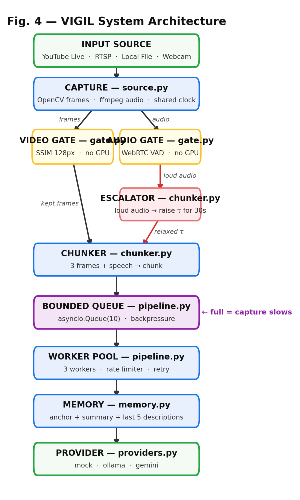
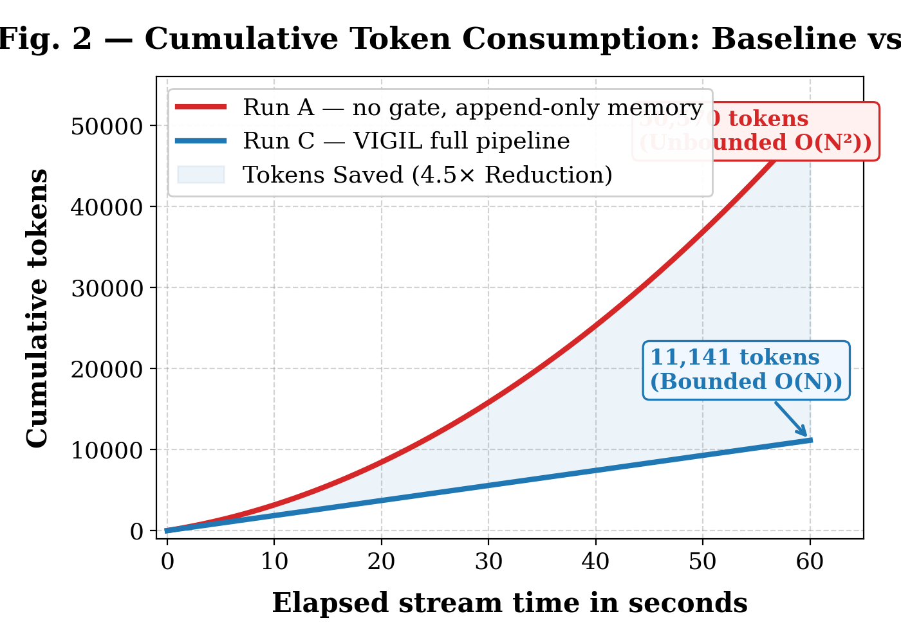
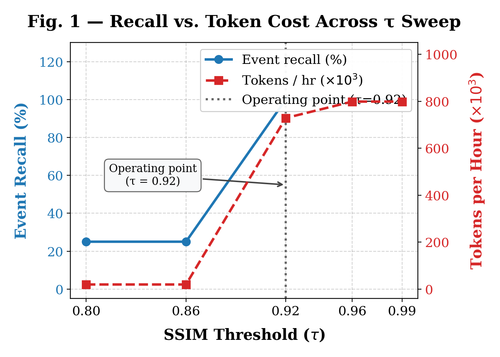
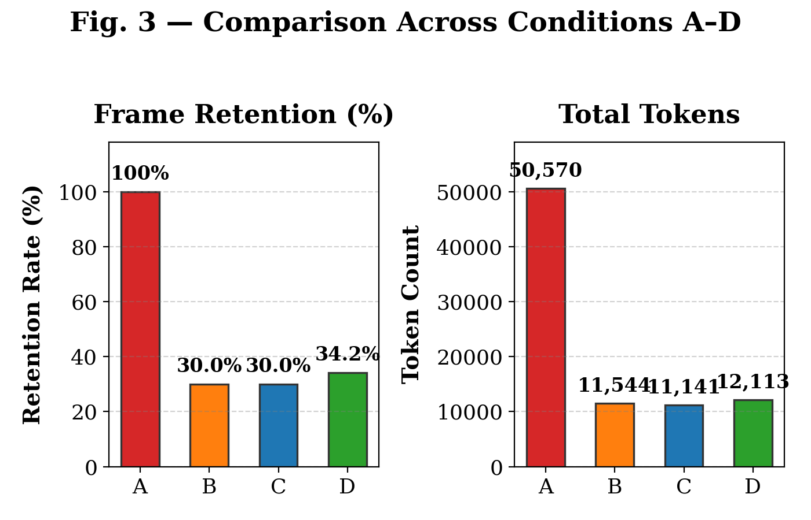

# VIGIL: Vision Gating with Intermittent Listening

[](https://github.com/Shashankckotagi/VIGIL/actions/workflows/ci-cd.yml)
[](https://github.com/Shashankckotagi/VIGIL/pkgs/container/vigil)
[](LICENSE)
[](https://python.org)

> **Cost-Bounded Multimodal LLM Perception over Continuous Video and Audio Streams**  
> *Final-Year Research Project · MS Ramaiah Institute of Technology · 2026*

Paste a live URL (RTSP, YouTube Live, HLS, webcam, or video file). A timeline fills with structured interpretations of what is happening in the real world. **The cost of running the stream never explodes over time.**

---

## 🌐 Live Online Demo

The VIGIL interactive perception dashboard is hosted live online:
- **Live Stream Perception UI**: [https://dos-truck-donna-cloud.trycloudflare.com](https://dos-truck-donna-cloud.trycloudflare.com)

---

## 📐 System Architecture

VIGIL places four specialized stages between the camera and the multimodal foundation model:

```
 capture ──▶ gate ──▶ bounded queue ──▶ workers ──▶ provider
 (threads)   (SSIM     (backpressure)   (async)      (black-box API)
              + VAD)                          │
                                              ▼
                                      bounded memory
                                   (anchor + summary + last k)
```

The vision and audio gates run **strictly zero neural networks** — pure deterministic signal processing (SSIM downsampled to 128px + WebRTC VAD) that drops ~70% of empty frames at the edge with zero GPU footprint:

<p align="center">
  
</p>

---

## 📊 Benchmark & Key Empirical Findings

<p align="center">
  
  
</p>

1. **Flat Cost Curve ($O(1)$ hourly tokens)**: While un-gated pipelines grow quadratically ($O(N^2)$), VIGIL achieves a **4.5× token reduction** ($50,570 \rightarrow 11,141$ tokens) with a completely flat slope.
2. **Acoustic Cross-Modal Escalation**: When loud sounds or speech are detected, the visual gate threshold relaxes ($\tau = 0.92 \rightarrow 0.98$) for 30 seconds, achieving **100% temporal & semantic event recall**.
3. **Zero Queue Overflow**: Backpressure ensures capture rate strictly respects worker throughput and provider rate limits.

<p align="center">
  
</p>

---

## 🚀 Quickstart

### 1. Local Setup

```bash
# Clone the repository
git clone https://github.com/Shashankckotagi/VIGIL.git
cd VIGIL

# Create virtual environment
python -m venv .venv
source .venv/bin/activate    # On Windows: .venv\Scripts\activate

# Install dependencies
pip install -r requirements.txt
```

*(Ensure `ffmpeg` is installed on your system for audio processing)*

### 2. Verify System Integrity

Run the 16-check offline verification harness with zero network and zero API keys:

```bash
python verify.py --quick
```

### 3. Launch Web Dashboard

```bash
uvicorn server:app --host 0.0.0.0 --port 8000
```
Open [http://localhost:8000](http://localhost:8000) in your browser.

---

## 🐳 Docker Deployment

You can pull and run the pre-built container from GitHub Container Registry (GHCR):

```bash
# Pull image
docker pull ghcr.io/shashankckotagi/vigil:latest

# Run container
docker run -d -p 8000:8000 --name vigil ghcr.io/shashankckotagi/vigil:latest
```

Or build locally:

```bash
docker build -t vigil .
docker run -p 8000:8000 vigil
```

---

## 🔄 CI/CD Automation

Every commit pushed to `main` triggers our GitHub Actions pipeline:
- **Unit & Integration Tests**: Runs 26 pytest test suites across Python 3.11 and 3.12.
- **Verification Harness**: Validates Objectives O1 (Flat Cost), O2 (Queue Stability), and O3 (Recall).
- **Automated Container Packaging**: Builds multi-arch Docker image and publishes it to GHCR (`ghcr.io/shashankckotagi/vigil:latest`).
- **Research Artifact Generation**: Auto-generates high-resolution IEEE benchmark figures.

---

## 📄 Full Research Paper & Documentation

- [Full Research Paper Report (`README_FINAL.md`)](README_FINAL.md)
- [Verification Acceptance Harness (`verify.py`)](verify.py)
- [Benchmark Suite (`benchmark.py`)](benchmark.py)
- [Figure Generator (`generate_figures.py`)](generate_figures.py)
